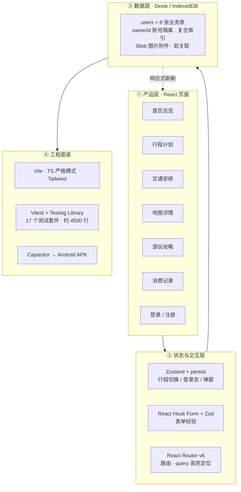
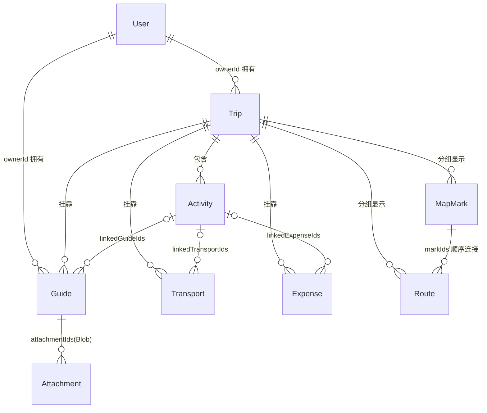

# 🧳 Traveltheworld — 旅游生活管理 App

一款纯本地运行的个人旅游生活管理应用：规划行程、安排交通、标注地图、收藏攻略、记录消费，全流程一个应用搞定。数据保存在浏览器本地（IndexedDB），**无需后端、无需云服务**，支持手机号注册登录与**多账号数据隔离**，并可打包为 Android APK。

## ✨ 功能特性


* 🗂️ **6 大业务模块**：首页总览 / 行程计划 / 交通安排 / 地图详情 / 游玩攻略 / 消费记录

* 🔗 **全局行程切换器**：左侧导航选定行程后，5 个业务模块数据自动联动筛选

* 🔄 **跨模块关联**：活动可关联交通 / 消费 / 攻略，双向跳转并高亮定位目标条目

* 📍 **地图标注与 POI 检索**：Leaflet + 高德瓦片（OSM 可一键切换），搜索地点、地图点选标注、绘制路线

* 📴 **离线优先**：除地图瓦片外全部功能断网可用；地图加载失败时本地标注列表仍可访问

* 🔐 **账号与数据隔离**：手机号注册 / 登录，密码 SHA-256 加盐哈希存储（不落明文），多账号数据相互隔离

* 💾 **数据持久**：IndexedDB 本地存储，关闭浏览器、重启电脑数据不丢失

* 🖼️ **Liquid Glass 视觉**：macOS 风格深色玻璃拟态界面（Notion / Linear 式简约交互）

* 📱 **多端交付**：Web 端 + 移动端底部悬浮导航 + Capacitor 打包 Android APK

## 🏗️ 架构总览




## 🧭 模块功能


| 模块          | 功能说明                                                                             |
| ----------- | -------------------------------------------------------------------------------- |
| **首页总览**    | 信息聚合页：当前行程概况（预算 vs 实际）、临近交通、消费分类占比、收藏攻略摘要，一键跳转各模块                                |
| **行程计划**    | 行程 CRUD（名称 / 目的地 / 起止日期 / 同行人 / 预算 / 状态）；活动按 "天 + 上午 / 下午 / 晚上" 时段组织，可关联交通、消费、攻略 |
| **交通安排**    | 航班 / 火车 / 大巴 / 地铁 / 网约车 / 自驾 6 类安排管理，按出发时间排序，状态（待出行 / 已完成 / 已取消）切换               |
| **地图详情**    | 唯一联网模块：地图点选添加标注（按类型区分图标）、高德 POI 文本搜索一键标注、多标注连成路线、左侧列表点击地图定位                      |
| **游玩攻略**    | 收集目的地攻略，支持分类（景点 / 美食 / 购物 / 文化 / 避坑 / 必备）、标签、收藏，可粘贴截图（Blob 存储）                   |
| **消费记录**    | 记录每笔花费（6 大分类），按行程汇总：总花费 + 分类占比图 + 预算 vs 实际对比                                     |
| **登录 / 注册** | 手机号注册登录（本地模拟验证码 `123456`），密码加盐哈希存储，多账号数据隔离                                       |
| **设置**      | 当前账号展示、退出登录（二次确认）、数据存储说明                                                         |

## 🛠️ 技术栈


| 类别   | 技术                                        | 用途                                        |
| ---- | ----------------------------------------- | ----------------------------------------- |
| 构建   | Vite 5                                    | 开发服务器与打包                                  |
| 框架   | React 18 + TypeScript（严格模式）               | 组件化 UI 与类型安全                              |
| 样式   | Tailwind CSS 3                            | 原子化样式，Liquid Glass 深色玻璃拟态主题（主色 `#0A84FF`） |
| 路由   | React Router v6                           | 模块路由与跨模块跳转（`?highlight=` 定位高亮）            |
| 状态管理 | Zustand + persist                         | 全局行程切换器、登录态、弹窗管理（localStorage 持久化）        |
| 数据存储 | Dexie.js（IndexedDB）                       | 9 张表、多字段索引、复合索引、Blob 图片附件、版本升级迁移          |
| 地图   | Leaflet + react-leaflet                   | 地图标注、路线绘制、POI 检索（高德瓦片 / OSM 可切换）          |
| 图表   | Recharts                                  | 消费分类占比、预算对比                               |
| 表单   | React Hook Form + Zod                     | 各模块弹窗表单与类型安全校验                            |
| 安全   | Web Crypto API                            | SHA-256 加盐密码哈希、随机盐                        |
| 测试   | Vitest + Testing Library + fake-indexeddb | 单元 / 组件测试，浏览器存储模拟                         |
| 打包   | Capacitor 7                               | 打包 Android APK                            |

## 📦 快速开始


```
# 安装依赖
npm install

# 启动本地开发服务器
npm run dev
```

浏览器打开 [http://localhost:5173](http://localhost:5173) 即可使用。注册账号时验证码为本地模拟的固定值 `123456`（不真实发送短信）。

## 🧪 测试


```
npm test        # 运行全部测试（vitest run）
npm run test:watch  # 监听模式
```

共 17 个测试套件（约 4500 行），覆盖：认证与密码哈希、多账号数据隔离、数据持久化、全局行程联动、跨模块跳转、断网降级、各模块 CRUD 等场景。

## 📱 构建与打包


```
# 构建 Web 产物（tsc 类型检查 + vite build）
npm run build

# 同步并构建 Android 工程
npx cap sync android
```

`android/` 目录为 Capacitor Android 工程，可用 Android Studio 打开后构建安装包（APK）。

## 📁 项目结构


```
src/
├─ main.tsx / App.tsx        入口与路由挂载（启动时恢复登录态）
├─ routes/router.tsx         路由配置
├─ layout/                   左侧导航 + 全局行程切换器 + 移动端底部导航
├─ pages/                    六大模块 + Auth（登录注册）+ Settings
│  ├─ Home/                  首页总览（聚合摘要）
│  ├─ Trips/                 行程计划（行程 + 活动）
│  ├─ Transports/            交通安排
│  ├─ Map/                   地图详情（Leaflet + POI 检索 + 瓦片源封装）
│  ├─ Guides/                游玩攻略（Blob 截图附件）
│  ├─ Expenses/              消费记录（Recharts 汇总）
│  ├─ Auth/                  手机号登录 / 注册
│  └─ Settings/              账号管理与数据说明
├─ db/
│  ├─ schema.ts              Dexie 数据库定义（v1 → v2 升级）
│  ├─ crud.ts                各实体 CRUD（软关联删除、引用清理）
│  ├─ auth.ts                注册 / 登录 / 密码哈希 / 错误码
│  ├─ scope.ts               账号读取收口（ownerAll / ownerByTrip / ownerGet）
│  └─ ownerContext.ts        当前账号上下文（写入钩子注入 ownerId）
├─ store/                    Zustand：行程切换 / 登录态 / 弹窗
├─ components/               通用组件（Modal / ConfirmDialog / EmptyState / 表单）
├─ types/index.ts            实体类型定义（Trip / Activity / Transport ...）
└─ test/                     17 个测试套件 + 测试辅助
```

## 💾 数据模型与账号隔离

数据模型以「行程」为中心，其余实体既可挂靠行程、也可独立存在（如随手记一笔消费、收藏一篇攻略）：




**多账号隔离实现**：


* Dexie schema v2 升级：新增 `users` 表（手机号唯一索引），8 张业务表统一增加 `ownerId` 字段与复合索引（如 `[ownerId+tripId]`），旧数据原地保留；

* 写入侧：`creating` 钩子根据当前登录账号自动注入 `ownerId`，业务代码无需感知；

* 读取侧：`scope.ts` 统一收口（`ownerAll` / `ownerByTrip` / `ownerGet`），保证只返回当前账号数据；

* 迁移：首个账号注册时，历史 "无主" 数据一次性划归该账号，旧版本数据零丢失升级。

## 📄 文档


* [PRD.md](./PRD.md) — 产品需求文档（v1 六大模块 + v2.0 登录与账号功能）

* [DEV\_PLAN.md](./DEV_PLAN.md) — 12 阶段开发计划与验收标准

## 🗺️ 计划中 / 暂未实现


* 数据导入 / 导出（备份恢复）

* 多币种汇率自动换算

* 离线地图瓦片预下载

* 云端同步与多设备协作

* 真实短信验证码接入

## 📄 License

当前未指定开源协议，保留所有权利。如需开源请在仓库中补充 LICENSE 文件。